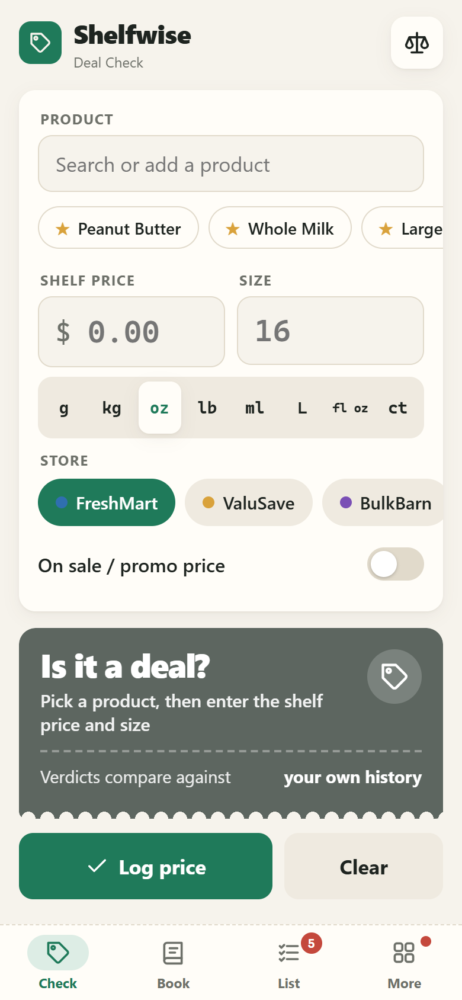
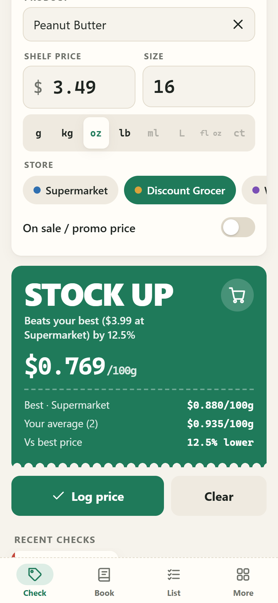
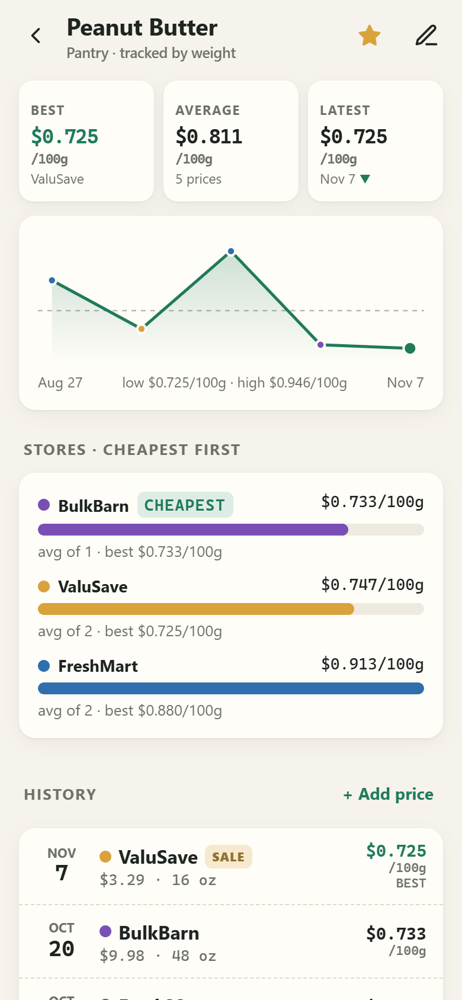
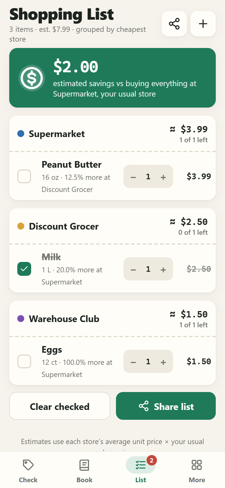
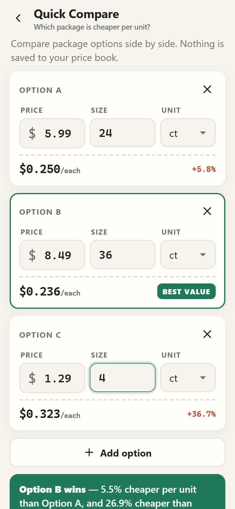

# Shelfwise

**Your pocket price book: know in two seconds if that shelf price is a real deal, based on what you've actually paid.**

## The problem

Frugal shoppers agree that the only reliable way to spot a real deal is to keep a "price book" of unit prices across stores. But most people still use paper or spreadsheets, because no app makes it easy:

- [The Dollar Stretcher](https://thedollarstretcher.com/frugal-living/food/digital-grocery-price-book-solutions-and-apps/) says no grocery price-book app automates tracking well, and recommends a spreadsheet instead.
- The best-known [Price Book app](https://apps.apple.com/us/app/price-book-track-grocery-price/id1431720584) is iOS-only, has ads and in-app purchases, and averages about 3.0 stars.
- [Price Logger](https://apps.apple.com/us/app/-/id6473100414) needs a subscription and the cloud just to highlight the best unit price.
- Guides like [Money Smart Family](https://moneysmartfamily.com/price-tracker-sheet/) tell shoppers to watch unit prices to catch **shrinkflation**, then hand out printable sheets.
- [Money Crashers](https://www.moneycrashers.com/making-grocery-price-book/) says tracking prices across several stores is the only way to get the best price, and people do it by hand.
- [Vertex42's Excel price-book template](https://www.vertex42.com/ExcelTemplates/grocery-price-book.html) has a unit-price calculator, which shows people want this math and currently do it in spreadsheets.

Shelfwise is a clean, offline, ad-free Android price book. Its main job is to give you a quick verdict while you're standing in the aisle.

## Features

- **Deal Check (home):** pick or type a product, enter the shelf price, package size and unit (g / kg / oz / lb / ml / L / fl oz / ct), and choose a store. You get a big color-coded verdict based on your own history:
  - **STOCK UP:** at or below your best-ever price, or 15%+ below your average
  - **GOOD:** below your average
  - **FAIR:** within ±5% of your average
  - **SKIP:** above your average

  The card also shows the normalized unit price, how it compares to your best price and which store had it, and what this size would cost at your best price. One tap logs it.
- **Price Book:** searchable product list with category and staple filters. Each row shows the best unit price, the store that's cheapest on average, and a trend arrow.
- **Product detail:** best, average and latest unit prices; an inline SVG sparkline; per-store ranking bars; and the full history with sale and shrink badges. You can edit or delete any entry.
- **Automatic unit conversion:** metric and imperial convert within each unit family, so a 1 lb bag and a 500 g bag compare correctly. You choose how prices display (per 100 g, kg, oz or lb; per 100 ml, L or fl oz).
- **Quick Compare:** put 2–4 package options side by side. It highlights the winner and shows the percent difference. Nothing is saved.
- **Shrinkflation alerts:** if the package gets smaller at the same store while the price stays the same or rises, the entry is flagged with the hidden price increase. All flagged entries are collected in **Shrink Watch**.
- **Smart shopping list:** items are grouped by the store where each is historically cheapest. You get per-store subtotals, estimated savings versus your usual store, check-off, quantities, and plain-text sharing.
- **Stores and data:** store names and color tags, a default store, categories, currency symbol, adjustable verdict thresholds, and light, dark or system theme. You can back up and restore everything as JSON (copy or share), load sample data, or reset.
- Works fully offline with no account and no ads. Your data never leaves the phone.

## Screenshots

| Deal Check | Verdict | Product detail |
|---|---|---|
|  |  |  |

| Shopping list | Quick Compare |
|---|---|
|  |  |

## Install

Download `app-release.apk` from this repository's **GitHub Releases** page and open it on your Android phone. You may need to allow installs from unknown sources.

## Tech notes

- Plain HTML, CSS and JavaScript in `app/src/main/assets/www/` (`index.html`, `styles.css`, `app.js`). No frameworks, CDNs, web fonts or network requests.
- Runs in a thin Android WebView shell (`MainActivity.java`) with a small native bridge for toast, vibrate and share. The hardware back button closes sheets and panels first.
- All data is stored in `localStorage` under `shelfwise.v1`, as one JSON object holding settings, stores, categories, products, entries, list and recent checks. Unit prices are computed on the fly from the stored price and size, converted to grams, millilitres or a count.
- Automated QA: `_qa/scenario.js` runs the IDEA test scenarios (verdicts, unit conversion, shrinkflation, Quick Compare, list, persistence, export/import, validation) in headless Chromium.

Built autonomously by the Auto Builder agent swarm (Claude Code).
